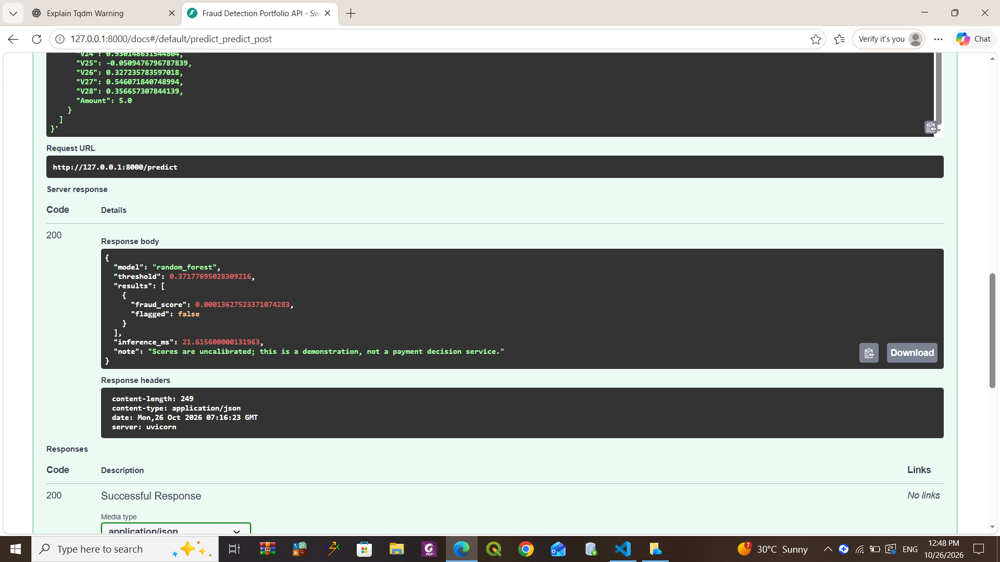

# Credit Card Fraud Detection — Machine Learning, PyTorch & Local Model Serving

An imbalanced-classification portfolio project comparing Logistic Regression, a tuned Random Forest, and two custom PyTorch neural networks. The pipeline validates transaction data, selects models and thresholds using validation data, generates Random Forest SHAP explanations, logs experiments with MLflow, and serves saved-model predictions through FastAPI.

**Recorded result:** the validation-selected Random Forest achieved **0.8131 average precision, 89.32% precision, 77.75% recall, and 0.8313 F1** on 212,795 historical test transactions.

**Verification:** a successful local HTTP 200 prediction response and **four passing tests with no skips** were demonstrated on Windows. Docker configuration is included, but container execution and cloud deployment have not been verified. No paid API key or GPU is required.

## Verified local API demonstration

The screenshot below shows a successful **HTTP 200** response from the local `/predict` endpoint using the validation-selected Random Forest. The request returned a fraud score below the decision threshold and `flagged: false`.



The displayed 21.6 ms is the timing of this single request within the prediction handler, not an average latency benchmark or proof of cloud deployment.

## Technology

Python · pandas · NumPy · scikit-learn · PyTorch · SHAP · MLflow · FastAPI · Uvicorn · Matplotlib · joblib · unittest

## Dataset and preparation

Use the [ULB credit-card fraud dataset on Kaggle](https://www.kaggle.com/datasets/mlg-ulb/creditcardfraud), saved as `data/creditcard.csv`.

- Inputs: `Time`, `V1` through `V28`, and `Amount` — 30 numeric features.
- Target: `Class`, where `1` means fraud and `0` means legitimate.
- V1–V28 are precomputed PCA features. The API needs these features; it cannot transform raw card details into them.
- Data checks reject missing/infinite values, incorrect columns, nonnumeric data, invalid labels, and negative Time/Amount.
- Exact duplicate rows are removed before splitting. Identical feature vectors with conflicting labels stop execution.
- Duplicate removal is a modeling choice, not proof that duplicate transactions were erroneous.

The recorded split contains **283,726 retained rows**:

| Partition | Rows | Approximate share |
|---|---:|---:|
| Training | 56,744 | 20% |
| Validation | 14,187 | 5% |
| Historical test | 212,795 | 75% |

The original 25% development / 75% test split was retained to limit training and cross-validation runtime. Development data is split again into 80% training and 20% validation. Both splits use stratification and seed 42. This trades away training data and leaves few fraud examples for model selection; it is not a generally preferred split.

**Evaluation limitation:** the outer test partition was previously examined in the earlier project if the dataset and row order are unchanged. These are retrospective benchmark results, not performance on a fresh independent holdout. Random splitting also does not establish performance on future transactions.

## Training and model selection

1. Validate and deduplicate the dataset; create disjoint training, validation, and test partitions.
2. Fit Logistic Regression using a StandardScaler pipeline and balanced class weights.
3. Tune Random Forest with **RandomizedSearchCV: four configurations × five stratified folds**, selecting by average precision (AP).
4. Train two PyTorch multilayer perceptrons with training-only scaling.
5. Select neural checkpoints and the serving model using validation AP.
6. Choose each model's threshold using validation F2, which emphasizes recall.
7. Freeze these choices, evaluate the test partition, save artifacts, and check saved-model inference consistency.

The test scores are reported for comparison; they are not used to choose the serving model. A shared small validation set is used for early stopping, model selection, and threshold selection, which can overfit validation performance.

### PyTorch architectures

| Setting | Implementation |
|---|---|
| Architecture A | 30 → 32 → 16 → 1 |
| Architecture B | 30 → 64 → 32 → 1 |
| Hidden activations | ReLU |
| Dropout | 0.2 after each hidden activation |
| Loss | BCEWithLogitsLoss with training-derived positive-class weight |
| Optimizer | Adam, learning rate 0.001, weight decay 0.0001 |
| Batch size | 512 |
| Training limit | Up to 20 epochs; early stopping after four non-improving epochs |
| Checkpoint selection | Best validation AP |
| Inference | Evaluation mode and sigmoid applied to output logits |

The recorded positive-class loss weight was approximately **602.66**. Neural networks are included as evaluated alternatives; they do not have to outperform the Random Forest.

### Selected Random Forest

| Parameter | Value |
|---|---:|
| `n_estimators` | 100 |
| `max_depth` | 8 |
| `min_samples_leaf` | 1 |
| `class_weight` | None |
| Best mean cross-validation AP | 0.7913 |
| Validation AP | 0.7976 |
| Decision threshold | 0.37177695028309216 |

## Recorded results

Source: the separately supplied `test_metrics.csv` and `metadata.json` from the completed `portfolio` run. The source ZIP does not bundle the dataset or trained artifacts.

| Model | Validation AP | Test AP | ROC-AUC | Precision | Recall | F1 |
|---|---:|---:|---:|---:|---:|---:|
| Logistic Regression | 0.7583 | 0.7347 | 0.9622 | 87.79% | 74.93% | 0.8085 |
| **Random Forest — selected** | **0.7976** | **0.8131** | **0.9652** | **89.32%** | **77.75%** | **0.8313** |
| PyTorch 32–16 | 0.7155 | 0.7450 | 0.9668 | 71.57% | 82.25% | 0.7654 |
| PyTorch 64–32 | 0.7273 | 0.7453 | 0.9604 | 84.36% | 77.46% | 0.8076 |

AP means **average precision**, not accuracy or trapezoidal PR-AUC. Overall accuracy is not the headline metric for this rare-event problem.

### Selected-model confusion matrix

| Actual class | Predicted legitimate | Predicted fraud |
|---|---:|---:|
| Legitimate | 212,407 | 33 |
| Fraud | 79 | 276 |

The Random Forest detected **276 of 355 fraud transactions**, missed 79, and produced 33 false alerts. It flagged 309 transactions, approximately **0.1452%** of the test set. The smaller PyTorch network detected 292 fraud transactions but produced 116 false alerts, illustrating the precision–recall tradeoff.

## Explainability, tracking, and cost scenarios

**SHAP:** the training code explains the Random Forest using TreeExplainer, verifies additivity, and saves global and local plots. Global importance uses up to 100 sampled validation transactions. The local plot explains the highest-scored transaction in that sample, which is not necessarily a true fraud. Attributions are not causal explanations; anonymized PCA features limit business interpretation.

**MLflow:** the pipeline logs each model's parameters, evaluation metrics, model artifacts, and metadata to a local SQLite tracking store. Neural training loss and validation AP are logged by epoch. This is experiment tracking, not a cloud deployment or production model registry workflow. Inspect the generated database and plots to review those outputs; they are not included in the source ZIP.

**Cost sensitivity:** the code evaluates eight assumption-based scenarios using prevention rates of 50%/80%, review costs of 1/5 currency units per alert, and extra false-alert costs of 0/5 units. It calculates:

```text
Simulated cost = total fraud amount
                 - prevention rate × detected fraud amount
                 + review cost × number of alerts
                 + extra false-alert cost × number of false alerts

Simulated net savings = total fraud amount - simulated cost
```

These are simulations in dataset currency units, not measured financial savings. No financial result is claimed here because this run's cost output was not supplied for review.

## Project files

| File | Purpose |
|---|---|
| `core.py` | Validation, deduplication, splits, threshold selection, metrics, and cost arithmetic |
| `neural.py` | PyTorch architectures, training, and batched inference |
| `train.py` | Training, model selection, evaluation, SHAP, MLflow, and artifact generation |
| `predict.py` | Saved-model loading and consistent feature ordering/preprocessing |
| `app.py` | FastAPI health, schema, and prediction routes |
| `tests/test_pipeline.py` | Core checks and saved-model/API integration test |
| `Fraud_Detection_Extension.ipynb` | Notebook wrapper around the Python modules |
| `requirements.txt` | Dependency ranges |
| `Dockerfile`, `compose.yaml` | Container configuration; execution unverified |
| `LEARN_IN_ORDER.md` | Guide to understanding the implementation |
| `START_HERE.md`, `VALIDATION.md` | Earlier setup and validation notes; see current instructions below |

**Path correction:** `train.py` now writes to `artifacts/run_<timestamp>/`. The older notebook, START_HERE instructions, and Compose configuration still assume model files directly under `artifacts/`. Use the run-folder selection below. Do not blindly use notebook “Run All” after training has already completed.

## Run locally on Windows / PowerShell

Run commands from the extracted project root containing `train.py` and `app.py`.

### 1. Install dependencies for a fresh setup

If your existing environment already works, keep it. For a new installation with Python 3.12 available:

```powershell
py -3.12 -m venv .venv
.\.venv\Scripts\python.exe -m pip install --upgrade pip
.\.venv\Scripts\python.exe -m pip install -r requirements.txt
```

The submitted execution used Python 3.14 on Windows. The dependency file uses ranges, not an exact lock, so a fresh environment may resolve different versions. Record a working environment with:

```powershell
.\.venv\Scripts\python.exe -m pip freeze > requirements-lock.txt
```

### 2. Train once, or reuse an existing completed run

Place `creditcard.csv` under `data/`. For a new full experiment:

```powershell
.\.venv\Scripts\python.exe train.py --data data/creditcard.csv --out artifacts
```

Each invocation creates a new dated folder. A completed run contains `completion.json`. Skip training if you already have a completed run. Optional `--quick` runs use fewer RF candidates and neural epochs and are for debugging, not the recorded portfolio results.

### 3. Select a completed run

```powershell
$run = Get-ChildItem .\artifacts -Directory |
    Where-Object { Test-Path (Join-Path $_.FullName "completion.json") } |
    Sort-Object Name -Descending |
    Select-Object -First 1

if (-not $run) { throw "No completed training run found." }

$env:ARTIFACT_DIR = $run.FullName
$env:TEST_ARTIFACT_DIR = $run.FullName
Get-Content (Join-Path $run.FullName "RESULTS.md")
```

Confirm `metadata.json` contains `"mode": "portfolio"`. This selects the latest completed folder, not the best test score. Environment variables apply to the current terminal; repeat this block in a new terminal when needed.

### 4. Run all four tests

```powershell
.\.venv\Scripts\python.exe -m unittest discover -s tests -v
```

The Windows terminal output supplied on 26 October 2026 confirmed **4 tests passed, 0 failures, and 0 skipped tests**. The results below summarize that execution; this documentation update did not rerun training or the artifact-dependent tests.

| Test | Result |
|---|---|
| `test_cost_arithmetic` | Passed |
| `test_dedup_and_disjoint_splits` | Passed |
| `test_threshold_and_confusion` | Passed |
| `test_api_and_saved_scores` | Passed |

Final terminal summary:

```text
Ran 4 tests in 12.057s

OK
```

The API test emitted a `StarletteDeprecationWarning` about its HTTP client dependency, then passed. The warning did not cause a failure or skip.

All four passed without skips. Checks cover cost arithmetic, threshold/confusion counts, deduplication/conflicting labels, disjoint partitions, and saved-model/API consistency. The API test also checks empty batches, missing features, extra labels, negative amounts, and feature-order invariance. Without `TEST_ARTIFACT_DIR`, the API test is skipped. The test client starts the app internally; a separate Uvicorn process is unnecessary for tests.

### 5. Start the API

In the terminal where `ARTIFACT_DIR` is set:

```powershell
.\.venv\Scripts\python.exe -m uvicorn app:app --host 127.0.0.1 --port 8000
```

Keep the terminal running. Open:

- Health: http://127.0.0.1:8000/health
- Expected features: http://127.0.0.1:8000/schema
- Interactive documentation: http://127.0.0.1:8000/docs

In the documentation, select **POST /predict → Try it out**, paste the complete contents of the selected run's `example_request.json`, and click **Execute**. Do not execute the JSON file as Python. Press Ctrl+C in the server terminal when finished.

The request contains a `transactions` list with 1–1,000 rows. Each row must contain exactly the 30 feature names, with finite numeric values and nonnegative Time/Amount. Do not include `Class`.

A demonstrated HTTP 200 response included:

```json
{
  "model": "random_forest",
  "threshold": 0.37177695028309216,
  "results": [
    {
      "fraud_score": 0.00013627523371074283,
      "flagged": false
    }
  ],
  "inference_ms": 21.615600000131963,
  "note": "Scores are uncalibrated; this is a demonstration, not a payment decision service."
}
```

This is one observed request, not an average latency benchmark. Scores are uncalibrated; `flagged: false` does not prove a transaction is legitimate. The handler timing excludes network transit. The generated `inference_benchmark.json` separately measures local model inference only.

### 6. Inspect MLflow

In a separate terminal, run the completed-run selection block above, then:

```powershell
$dbPath = (Join-Path $run.FullName "mlflow.db").Replace('\', '/')
.\.venv\Scripts\python.exe -m mlflow ui --backend-store-uri "sqlite:///$dbPath" --host 127.0.0.1 --port 5000
```

Open http://127.0.0.1:5000 and select the `fraud_detection` experiment. Keep the run directory at its original location when browsing logged artifacts: MLflow uses absolute artifact URIs.

### 7. Read existing results in the notebook

Skip the training cell when results already exist. Replace the results cell's `OUTPUT = BASE / 'artifacts'` assignment with:

```python
completed_runs = sorted(
    p.parent for p in (BASE / 'artifacts').glob('run_*/completion.json')
)
if not completed_runs:
    raise FileNotFoundError('No completed training run found.')
OUTPUT = completed_runs[-1]
```

Keep that same `OUTPUT` for the remaining result, plot, and test cells. When deliberately starting a new notebook training run, capture the returned path with `OUTPUT = run(DATA, BASE / 'artifacts', quick=False)`.

## Optional Docker verification — not yet completed

The supplied Compose file mounts all of `artifacts/`, while model files now live in a dated subfolder. It needs an `ARTIFACT_DIR` override or a mount of the selected run before it can load these artifacts.

An alternative using the existing Dockerfile is below. With Docker available, stop the standalone API to free port 8000, select `$run` as above, and run:

```powershell
docker build -t fraud-api .
docker run --rm -p 127.0.0.1:8000:8000 --mount "type=bind,source=$($run.FullName),target=/app/artifacts,readonly" fraud-api
```

These commands are provided for future verification, not as evidence of a completed deployment. Dependencies resolved in the Python 3.12 container may differ from the training environment; saved-model compatibility must be checked. Repeat health/prediction checks before claiming containerized serving.

## Generated evidence and GitHub publishing

A completed run generates model files, metadata, split indices, CV results, neural training histories, test metrics/predictions, PR and confusion plots, SHAP plots/values, cost scenarios, an example request, an inference benchmark, MLflow records, and a completion marker.

Keep the dataset, virtual environment, full predictions, model binaries, and local tracking database outside GitHub. Publish selected small evidence files under `results/` and the demonstrated API screenshot under `images/api_prediction.png`.

For example, after selecting `$run`:

```powershell
New-Item -ItemType Directory -Force results | Out-Null
$evidence = @(
    'test_metrics.csv', 'metadata.json', 'rf_cv_results.csv',
    'confusion_matrix.png', 'precision_recall.png',
    'rf_shap_global.png', 'rf_shap_local.png'
)
foreach ($name in $evidence) {
    Copy-Item (Join-Path $run.FullName $name) (Join-Path 'results' $name)
}
```

The existing `.gitignore` excludes every CSV. To make only these selected result CSVs eligible for normal staging, append:

```gitignore
!results/test_metrics.csv
!results/rf_cv_results.csv
```

The supplied screenshot is already embedded above. Upload `images/api_prediction.png` alongside this README, preserving the relative path so GitHub can display it.

The training-generated `completion.json` always initializes API/Docker/cloud verification flags to false; it does not update them after manual testing. The subsequent passing test output and HTTP 200 screenshot are the evidence for local API verification.

## Scope and next improvements

This is a local portfolio demonstration, not a production payment-decision system. It has no demonstrated cloud deployment, production monitoring, authentication, TLS setup, or real-world financial impact. Only load model artifacts you trust.

Future work includes a genuinely unseen temporal/external evaluation, more training fraud examples, probability calibration using appropriate development data, broader test coverage, a locked environment, and verified container execution. Keep these separate from the capabilities already demonstrated.
